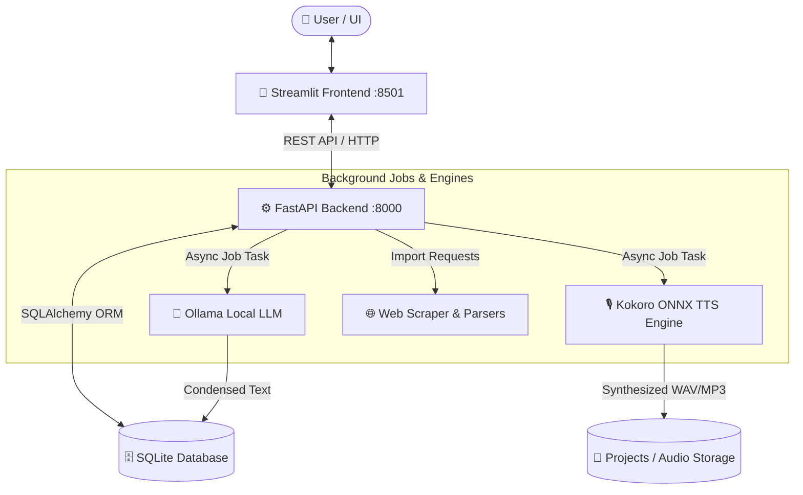

# 📚 AI Novel Condenser & Audiobook Generator

[](https://www.python.org/downloads/)
[](https://fastapi.tiangolo.com/)
[](https://streamlit.io/)
[](https://ollama.com)
[](https://github.com/thewh1teagle/kokoro-onnx)
[](LICENSE)

An end-to-end, privacy-focused, **100% local and offline** AI application that transforms lengthy novel chapters into condensed summaries (~50% original length) using local LLMs via Ollama, and converts them into studio-quality audiobooks using the fast local **Kokoro ONNX** text-to-speech engine.

---

## 💡 Overview & Core Capabilities

The **AI Novel Condenser & Audiobook Generator** bridges the gap between text condensation and audio narration. Whether you are an author, editor, or avid listener, this tool allows you to digest massive manuscripts quickly and turn them into natural-sounding audiobooks without uploading sensitive texts or personal data to third-party cloud services.

1. **Import Novel Chapters**: Paste raw text, upload files (`TXT`, `PDF`, `EPUB`), or scrape novel chapters directly from web URLs (such as Royal Road).
2. **AI-Powered Condensation**: Intelligently condense chapters to ~50% of their original word count using Ollama local LLMs while keeping plot integrity, tone, and character voices intact.
3. **High-Fidelity Audio Generation**: Synthesize condensed chapters into 24kHz natural speech using local Kokoro ONNX neural audio synthesis.
4. **Export & Compilation**: Download condensed manuscripts in `TXT`, `PDF`, or `DOCX` formats, or compile all chapters into a seamless `.wav` or `.mp3` audiobook.

---

## 🚀 Key Features

- 📁 **Project-Based Workspace Management**: Create separate projects for different books. Track word counts, condensation ratios, chapter orders, and audio compilation status.
- 📝 **Chapter-by-Chapter Condensation**: Condense text while preserving key narrative events, character development, and stylistic tone. Includes side-by-side diff/review of original vs condensed text.
- 🤖 **Multiple Local AI Models**: Full Ollama integration. Switch effortlessly between models like `Qwen 2.5 7B`, `Gemma 7B`, `Mistral 7B`, and `Llama 3.1 8B` (with auto-download capabilities).
- 🎙️ **High-Fidelity Narrator Voices**: Built-in 24kHz Kokoro ONNX engine with 8 natural narrator personas:
  - **Female Voices**: `af_bella` (Default), `af_sarah`, `af_nicole`, `af_sky`
  - **Male Voices**: `am_adam`, `am_michael`, `am_fenrir`, `am_puck`
- 🎧 **Audiobook Compilation**: Combine chapter narrations into a complete, cohesive audiobook with customizable chapter pause delays (silence insertion) in `WAV` or high-quality `MP3`.
- 📄 **Multi-Format Document Import & Export**:
  - **Import**: Plain text (`TXT`), Adobe Acrobat (`PDF`), Electronic Publication (`EPUB`), or web scrapers.
  - **Export**: Full manuscript export in formatted `TXT`, printable `PDF`, or editable Microsoft Word (`DOCX`).
- 🌐 **Web Scraping & Web Imports**: Direct chapter extraction from web pages, with tailored parsers for Royal Road and generic novel websites.
- 🔍 **Global Search & Replace**: Batch find and update names, terms, or places across all chapters in a project in one click.
- ✂️ **Chapter Merge & Split Tools**: Split lengthy chapters at designated points or merge multiple short chapters into a single chapter.
- ⚡ **Asynchronous Background Processing**: Background execution for condensation and audio generation jobs with real-time status updates and progress tracking.
- 🎨 **Dark Glassmorphism Interface**: Modern Streamlit frontend designed with custom CSS dark glassmorphism visuals for comfortable long-format editing.

---

## 🛠️ Tech Stack

| Component | Technology | Description |
| :--- | :--- | :--- |
| **Backend API** | FastAPI + Uvicorn | High-performance Python REST API managing worker jobs and asynchronous operations |
| **Database** | SQLite + SQLAlchemy | Persistent ORM storing project metadata, chapter contents, and processing logs |
| **Frontend UI** | Streamlit + Custom CSS | Glassmorphism dark-themed interactive web interface with built-in audio playback |
| **AI Engine** | Ollama API | Local LLM inference server supporting Qwen 2.5, Gemma, Mistral, and Llama 3.1 |
| **TTS Engine** | Kokoro ONNX (~120MB) | High-speed local neural text-to-speech engine running ONNX model at 24kHz |
| **Document Tools** | PyMuPDF, EbookLib, python-docx, ReportLab | Full parsing of EPUB/PDF/TXT files & manuscript PDF/DOCX generation |
| **Web Scraping** | BeautifulSoup4, Trafilatura, HTTPX | Web content scraping and clean chapter text extraction |
| **Audio Processing** | SoundFile, SciPy, PyDub, FFmpeg | Audio buffer manipulation, silence stitching, and MP3 conversion |

---

## 📐 Architecture & System Structure

```
run.py (orchestrator) → launches:
  ├── FastAPI backend (port 8000) — src/backend.py
  └── Streamlit frontend (port 8501) — src/frontend.py

src/
├── backend.py        — FastAPI REST API with background job workers
├── frontend.py       — Streamlit UI (dark glassmorphism design)
├── ollama_client.py  — Ollama LLM client for chapter condensation
├── tts_client.py     — Kokoro ONNX text-to-speech engine
├── scraper.py        — Web scraper for importing from URLs
├── audio_utils.py    — WAV merge, silence generation, MP3 conversion
├── document_utils.py — TXT/PDF/EPUB extraction, TXT/PDF/DOCX export
├── database.py       — SQLAlchemy models (Project, Chapter, ProcessingJob)
└── config.py         — Central configuration
```

### System Data Flow



---

## 📋 Setup Requirements

Before getting started, make sure your environment meets the following requirements:

- **Python**: Version 3.10 or higher (64-bit).
- **Ollama**: Installed and running locally ([https://ollama.com](https://ollama.com)).
- **FFmpeg**: *(Optional)* Required if you wish to export compiled audiobooks to `.mp3` format. If FFmpeg is absent, the system will output lossless `.wav` files.
- **Disk Space**: ~500 MB free space for Kokoro ONNX model weights and voice dictionaries (automatically downloaded on first TTS invocation).

---

## 💻 Installation & Usage

### Step 1: Clone & Setup Virtual Environment

```bash
# Navigate to the project directory
cd "new tool"

# Create a virtual environment
python -m venv venv

# Activate the virtual environment
# Windows (PowerShell / Command Prompt):
venv\Scripts\activate

# Linux / macOS:
# source venv/bin/activate

# Install dependencies
pip install -r requirements.txt
```

### Step 2: Start Local Ollama Service

In a separate terminal window, ensure Ollama is running:

```bash
ollama serve
```

*(Optional) Pre-pull your desired LLM model:*
```bash
ollama pull qwen2.5:7b-instruct
```

### Step 3: Run the Application

Launch the unified orchestrator script, which starts both the FastAPI backend and Streamlit frontend:

```bash
python run.py
```

Access the interfaces in your browser:
- 🎨 **Streamlit Interface**: [http://localhost:8501](http://localhost:8501)
- ⚙️ **FastAPI Interactive Docs**: [http://localhost:8000/docs](http://localhost:8000/docs)

---

## ⚙️ Configuration

Global parameters can be configured in [`src/config.py`](file:///c:/Users/soura/new%20tool/src/config.py) or overridden via environment variables:

| Variable | Default Value | Description |
| :--- | :--- | :--- |
| `BACKEND_HOST` | `127.0.0.1` | Host address for FastAPI backend |
| `BACKEND_PORT` | `8000` | Port for FastAPI backend |
| `OLLAMA_API_URL` | `http://localhost:11434` | Ollama service endpoint |
| `DEFAULT_MODEL` | `qwen2.5:7b-instruct` | Default LLM model for condensation |
| `DEFAULT_VOICE` | `af_bella` | Default narrator voice persona |
| `AUDIO_SAMPLE_RATE` | `24000` | Kokoro audio sampling rate (Hz) |
| `PROJECTS_DIR` | `./projects` | Directory storing project files and rendered audio |
| `MODELS_DIR` | `./models` | Cache location for Kokoro ONNX model files |

---

## ❓ Troubleshooting

> [!TIP]
> **Issue: Backend cannot connect to Ollama**
> - Verify that `ollama serve` is active by running `curl http://localhost:11434/api/tags` in your terminal.
> - If running on a non-standard port or remote host, set the `OLLAMA_API_URL` environment variable.

> [!NOTE]
> **Issue: MP3 output is unavailable**
> - PyDub requires `ffmpeg` to encode MP3 files. Ensure FFmpeg is installed and added to your system's `PATH` environment variable. If unavailable, audio generation will safely default to `.wav` format.

> [!IMPORTANT]
> **Issue: Kokoro ONNX download failed on first run**
> - On initial TTS execution, Kokoro ONNX assets (`kokoro-v1.0.int8.onnx` and `voices-v1.0.bin`) are retrieved from GitHub releases. Ensure an active internet connection during the first audio synthesis.

---

## 📜 License

This project is licensed under the **MIT License**. See the [LICENSE](LICENSE) file for full details.
